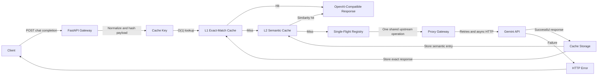

# Prospect AI


Prospect AI is an async LLM gateway built with FastAPI. It provides normalized exact-match caching,
optional semantic caching, per-request-key single-flight deduplication, and an OpenAI-compatible
`/v1/chat/completions` interface for an upstream provider such as Gemini.

## Project Overview

The gateway receives chat-completion requests, normalizes and hashes their cache-relevant fields,
and checks cache state before contacting the configured upstream provider. A cache miss is forwarded
through an async HTTP proxy, while successful upstream responses are stored for later requests.

Prospect AI is designed to:

- reduce repeated upstream Gemini calls;
- coalesce simultaneous identical non-streaming requests;
- preserve OpenAI-compatible request and response shapes;
- support exact and optional semantic cache lookup;
- surface upstream failures as HTTP errors rather than empty successful responses.

## Architecture





The in-process flow uses SHA-256 payload normalization for L1 keys, an in-memory cache backend,
and cosine-similarity search for L2 entries. Identical cache misses are grouped by the same
normalized key. Different cache keys remain independent.

## Core Features

### L1 Exact-Match Caching

Requests are normalized and hashed with SHA-256 in `core/normalizer.py`. The memory backend performs
O(1) exact lookup and stores successful upstream responses for later reuse.

Successful non-streaming responses expose their cache source:

| Header value | Meaning |
|---|---|
| `X-Prospect-Cache: l1` | Exact-match cache hit |
| `X-Prospect-Cache: l2` | Semantic cache hit |
| `X-Prospect-Cache: miss` | Successful upstream response |

Failed upstream responses do not include a cache-status header. Streaming responses do not expose
the cache header because the cache or upstream status is not known safely when the stream begins.
The OpenAI-compatible JSON body is unchanged.

### L2 Semantic Caching

The L2 implementation generates embeddings with FastEmbed and searches cached vectors using cosine
similarity. The default similarity threshold is `0.92`.

Live embeddings are currently disabled when `fastembed` is unavailable or cannot be imported.
In that case, L1 exact caching and request routing continue to operate; semantic cache lookup
cannot produce live embeddings.

### Single-Flight Request Deduplication

The proxy maintains an in-flight task registry keyed by normalized cache key. For identical
concurrent non-streaming requests:

- only one upstream operation runs;
- waiting callers receive the shared successful response or error;
- cancelling one waiter does not cancel the shared operation;
- inflight entries are removed after success or failure;
- one cache key does not serialize another cache key.

Streaming requests remain independent so one async SSE consumer cannot consume another client's
stream.

### Upstream Retries and Error Handling

The gateway retries retryable upstream HTTP responses and handles 429 and 5xx responses. Terminal
failures are returned as gateway HTTP errors:

- `429` for exhausted upstream rate limiting;
- `502` for connection failures or exhausted server errors;
- `503` for upstream 503 responses;
- `504` for upstream timeouts.

Failed upstream results are never cached.

## Technology Stack

- Python 3.11+
- FastAPI
- Uvicorn
- HTTPX
- Pydantic
- Typer
- FastEmbed for optional local embeddings
- Pytest and pytest-asyncio
- Ruff
- Hatchling

## Setup and Configuration

### Installation

Clone and install the project from source:

```bash
cd prospect-ai
python3 -m venv .venv
source .venv/bin/activate
python -m pip install -e ".[dev]"
```

### Environment Variables

The gateway reads:

| Variable | Purpose | Default |
|---|---|---|
| `UPSTREAM_BASE_URL` | OpenAI-compatible upstream base URL | `https://api.openai.com/v1` |
| `UPSTREAM_API_KEY` | Upstream provider credential | empty |

For Gemini, set the Gemini OpenAI-compatible endpoint and your Gemini API key in the gateway
process environment. Never place provider credentials in source code or command arguments that
are captured by shell history.

```bash
export UPSTREAM_BASE_URL="https://generativelanguage.googleapis.com/v1beta/openai"
export UPSTREAM_API_KEY="replace-with-your-gemini-api-key"
```

Do not commit API keys or print them in benchmark output.

### Run the Gateway

```bash
python -m uvicorn run:app --host 127.0.0.1 --port 8000
```

Verify the server:

```bash
curl http://127.0.0.1:8000/health
```

The gateway process owns the upstream credential. Clients only send requests to Prospect AI.

## API Usage

Send a non-streaming OpenAI-compatible request:

```bash
curl -i http://127.0.0.1:8000/v1/chat/completions \
  -H "Content-Type: application/json" \
  -d '{
    "model": "gemini-3.5-flash-lite",
    "messages": [
      {"role": "user", "content": "Explain what a database index is in two sentences."}
    ],
    "temperature": 0,
    "stream": false
  }'
```

Successful responses preserve the existing OpenAI-style JSON shape. The following is an
illustrative response only: actual Gemini usage values and response content may differ.

```json
{
  "object": "chat.completion",
  "model": "gemini-3.5-flash-lite",
  "choices": [
    {
      "index": 0,
      "message": {
        "role": "assistant",
        "content": "..."
      },
      "finish_reason": "stop"
    }
  ],
  "usage": {
    "prompt_tokens": 10,
    "completion_tokens": 0,
    "total_tokens": 10
  }
}
```

The response also includes `X-Prospect-Cache: miss`, `l1`, or `l2` where cache status is known.

## Benchmark

`benchmark.py` checks gateway health, creates unique prompts, and sends each miss followed by the
same exact payload as a potential L1 hit. A hit is counted only after HTTP 200 and
`X-Prospect-Cache: l1` are confirmed.

Run the benchmark:

```bash
python benchmark.py
```

Custom iterations:

```bash
python benchmark.py --iterations 50
```

### Verified Benchmark

The recorded benchmark attempted 20 iterations:

- 17 successful miss-hit pairs;
- 3 failed iterations:
  - HTTP 503: 1 iteration
  - HTTP 504: 2 iterations
- Mean cache miss latency: `10.790745 seconds`;
- Mean L1 cache hit latency: `0.002381 seconds`;
- Mean latency reduction: `99.98%`.

Miss latency includes upstream Gemini response time and any upstream retry behavior. The 17-pair
benchmark result should not be interpreted as a general provider latency guarantee.

For the exact upstream Gemini call count, inspect server logs during the benchmark for
`Cached response` and `L1 cache hit` entries. Benchmark timing alone cannot prove the exact provider
call count.

## Testing and Code Quality

Run the project test suite:

```bash
python -m pytest -q tests
```

Run Ruff across the repository:

```bash
python -m ruff check .
```

Verified state:

- `76` tests passed.
- `ruff check .` passed.

## Limitations

- The memory cache is process-local. Restarting the gateway loses all exact and semantic entries.
- Live L2 embeddings require FastEmbed. When `fastembed` is unavailable, live semantic embeddings
  are disabled and only exact caching and upstream behavior remain fully operational.
- Cache-status headers are exposed for successful non-streaming L1, L2, and upstream-miss responses.
  Streaming responses do not receive the header because cache status cannot be determined safely
  before the stream starts.
- The benchmark reports the gateway's complete HTTP latency, not only upstream provider time.
- The router module contains request-routing logic, but the live gateway currently forwards a
  request to the one upstream URL configured by `UPSTREAM_BASE_URL`.

## License

MIT License. See [LICENSE](LICENSE) for details.

Copyright (c) 2026 Prerna.
